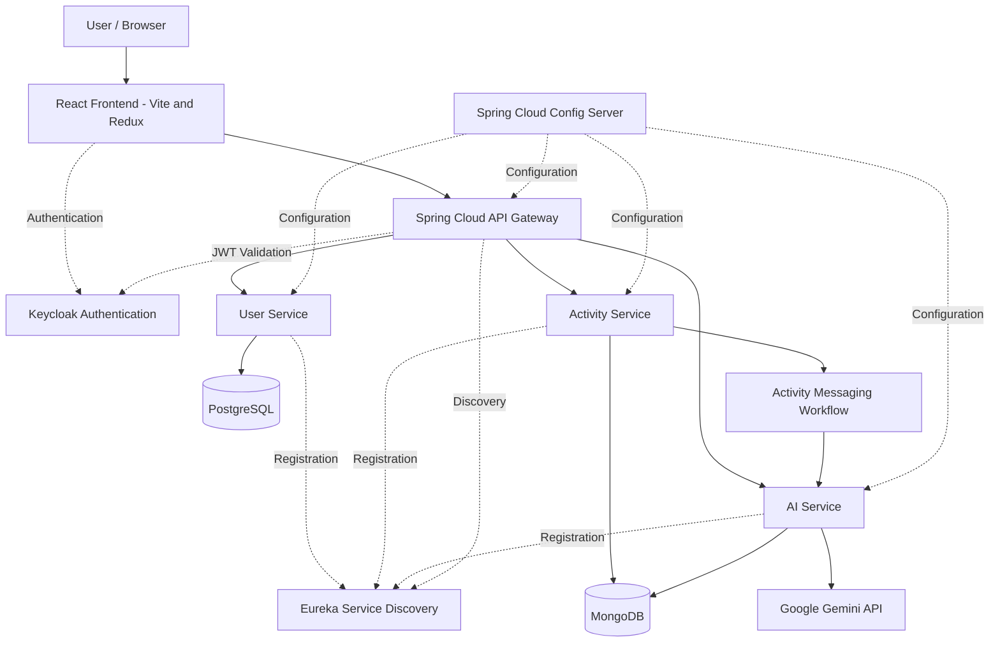

# FITPULSE — AI-Powered Fitness Tracking Platform

**FITPULSE** is a full-stack fitness tracking platform built using React, Spring Boot microservices, and AI-powered activity recommendations. It combines fitness activity management with a distributed backend architecture, service discovery, centralized configuration, and Keycloak-based authentication.

The project is designed around independently deployable backend services, allowing different responsibilities to be developed, maintained, and scaled separately.

## Table of Contents

- [Overview](#overview)
- [Key Features](#key-features)
- [Architecture](#architecture)
- [Microservices](#microservices)
- [Technology Stack](#technology-stack)
- [Request and Data Flow](#request-and-data-flow)
- [Security](#security)
- [Project Structure](#project-structure)
- [Getting Started](#getting-started)
- [Configuration](#configuration)
- [Future Improvements](#future-improvements)

---

## Overview

FITPULSE brings together a React frontend and a Spring Boot microservices backend to provide a foundation for fitness activity tracking and AI-assisted recommendations.

The system is divided into dedicated services:

- **User Service** — user registration and user data management.
- **Activity Service** — fitness activity management.
- **AI Service** — AI-assisted processing and fitness recommendations.
- **API Gateway** — centralized entry point for backend API requests.
- **Eureka Server** — service discovery for backend microservices.
- **Config Server** — centralized configuration management.

The platform integrates Keycloak for authentication and uses the Gemini API for AI-related processing.

## Key Features

- **Microservices Architecture:** Separates user management, activity management, and AI processing into independent backend services.
- **Centralized API Entry Point:** Routes frontend requests through Spring Cloud Gateway.
- **Authentication and Authorization:** Integrates Keycloak with the API Gateway.
- **Service Discovery:** Uses Netflix Eureka for service registration and discovery.
- **Centralized Configuration:** Uses Spring Cloud Config Server to manage service configuration.
- **Fitness Activity Management:** Provides backend functionality for handling fitness activities.
- **AI-Assisted Recommendations:** Integrates the Gemini API into the recommendation workflow.
- **Modern Frontend:** Uses React and Vite to deliver the client-side application.

---

## Architecture

FITPULSE follows a microservices architecture in which the frontend communicates with backend services through an API Gateway.

### High-Level Architecture




### Architectural Components

| Component | Responsibility |
|---|---|
| React Frontend | Provides the user interface and communicates with backend APIs. |
| API Gateway | Acts as the centralized entry point for API requests and integrates security and routing. |
| User Service | Handles user-related operations and persists user data. |
| Activity Service | Handles fitness activity operations and participates in the AI processing workflow. |
| AI Service | Processes activity-related information and generates AI-assisted recommendations. |
| Eureka Server | Maintains service registration and supports service discovery. |
| Config Server | Centralizes configuration for supported microservices. |
| Keycloak | Provides identity management and authentication infrastructure. |
| PostgreSQL | Stores user-service data. |
| MongoDB | Supports activity and recommendation data storage. |
| Gemini API | Provides the external AI capability used by the AI service. |

---

## Microservices

### 1. User Service

**Responsibility:** User registration and user data management.

The User Service is implemented using Spring Boot and Spring Data JPA, with PostgreSQL as its relational database.

Responsibilities include:

- Exposing user-related REST endpoints.
- Handling user registration requests.
- Persisting user information.
- Supporting integration with Keycloak user identities.
- Participating in Eureka service discovery.

**Technologies:** Java, Spring Boot, Spring Data JPA, PostgreSQL, Eureka Client.

### 2. Activity Service

**Responsibility:** Fitness activity management.

The Activity Service manages activity-related operations and participates in the workflow that sends activity information for AI processing.

Responsibilities include:

- Exposing REST endpoints for activity operations.
- Managing activity requests and responses.
- Persisting activity-related data.
- Integrating with other services where required.
- Participating in service discovery and the AI processing workflow.

**Technologies:** Java, Spring Boot, MongoDB, Eureka Client.

### 3. AI Service

**Responsibility:** AI-assisted processing and fitness recommendations.

The AI Service integrates with the Gemini API to support AI-related processing.

Responsibilities include:

- Processing activity-related information.
- Integrating with the Gemini API.
- Supporting fitness recommendation generation.
- Persisting recommendation data.
- Participating in the application's inter-service communication workflow.

**Technologies:** Java, Spring Boot, Google Gemini API, MongoDB.

### 4. API Gateway

**Responsibility:** Centralized access to backend services.

The API Gateway provides a single entry point for requests originating from the frontend.

Responsibilities include:

- Routing requests to backend services.
- Integrating with Keycloak-based authentication.
- Supporting JWT validation.
- Integrating with Eureka for service discovery.
- Reducing the need for the frontend to communicate directly with individual backend services.

**Technologies:** Spring Boot, Spring Cloud Gateway, Spring Security, OAuth 2.0 Resource Server, Keycloak, Eureka Client.

### 5. Eureka Server

**Responsibility:** Service discovery.

The Eureka Server provides a registry through which participating microservices can register themselves and discover other services.

This supports service-to-service communication without requiring every service to rely exclusively on hardcoded service addresses.

**Default port:** `8761`

### 6. Config Server

**Responsibility:** Centralized configuration management.

The Config Server provides configuration to supported microservices through Spring Cloud Config.

The repository contains configuration files for:

- User Service
- Activity Service
- AI Service
- API Gateway

This separates application configuration from service implementation and makes configuration management easier across the system.

---

## Technology Stack

| Category | Technologies |
|---|---|
| Frontend | React, JavaScript, Vite |
| Frontend State Management | Redux Toolkit |
| Backend Language | Java |
| Backend Framework | Spring Boot |
| API Communication | REST APIs |
| API Gateway | Spring Cloud Gateway |
| Service Discovery | Netflix Eureka |
| Configuration Management | Spring Cloud Config |
| Security | Spring Security, OAuth 2.0 Resource Server, Keycloak |
| Relational Database | PostgreSQL |
| NoSQL Database | MongoDB |
| AI Integration | Google Gemini API |
| Build Tool | Maven |
| Version Control | Git, GitHub |

---

## Request and Data Flow

### 1. Frontend to Backend

1. The user interacts with the React frontend.
2. The frontend sends API requests to the API Gateway.
3. The gateway applies the configured security and routing rules.
4. Requests are forwarded to the appropriate backend service.
5. The backend service processes the request and returns a response.

### 2. Authentication Flow

1. Keycloak manages user identity and authentication.
2. The frontend participates in the configured authentication flow.
3. Authenticated requests can carry a JWT access token.
4. The API Gateway validates tokens according to its security configuration.
5. Requests are processed according to the configured security rules.

### 3. AI Recommendation Flow

1. Activity information is handled by the Activity Service.
2. Activity information enters the configured inter-service messaging workflow.
3. The AI Service processes the information.
4. The AI Service integrates with the Gemini API for AI-assisted processing.
5. Recommendation data can be persisted for subsequent application use.

The exact message broker, event schema, and recommendation retrieval endpoints depend on the implementation and configuration.

---

## Security

FITPULSE integrates Keycloak with the API Gateway to support authentication and token validation.

Security-related components include:

- **Keycloak:** Identity and access management.
- **Spring Security:** Backend security configuration.
- **JWT:** Token-based authentication.
- **OAuth 2.0 Resource Server:** JWT validation support at the gateway

---

## Project Structure

```text
FITPULSE/
│
├── frontend/                  # React frontend application
│   ├── public/
│   ├── src/
│   │   ├── components/        # UI components
│   │   ├── services/          # API communication
│   │   ├── store/             # Redux state management
│   │   ├── App.jsx
│   │   └── main.jsx
│   ├── package.json
│   └── vite.config.js
│
├── userservice/               # User management microservice
│   ├── src/
│   └── pom.xml
│
├── activityservice/           # Fitness activity microservice
│   ├── src/
│   └── pom.xml
│
├── aiservice/                 # AI processing microservice
│   ├── src/
│   └── pom.xml
│
├── gateway/                   # API Gateway and security
│   ├── src/
│   └── pom.xml
│
├── eureka/                    # Service discovery server
│   ├── src/
│   └── pom.xml
│
├── configServer/              # Centralized configuration server
│   ├── src/
│   └── pom.xml
│
├── .gitignore
└── README.md
```

---


## Future Improvements

Potential areas for further development include:

- Automated testing across service boundaries.
- API documentation with OpenAPI and Swagger.
- Containerization with Docker and Docker Compose.
- CI/CD pipelines for automated testing and deployment.
- Centralized logging and distributed tracing.
- Health monitoring and service observability.
- Improved error handling and resilience between microservices.
- Production-grade secrets management and security hardening.
- Improved UI.

These are potential enhancements that could happen, not claims that the features are already implemented.

---

## Author

**Aditi Singh**

GitHub: [@AditiS77](https://github.com/AditiS77)

**Repository:** [FITPULSE](https://github.com/AditiS77/FITPULSE)

---

*FITPULSE — Bringing fitness tracking and AI-assisted recommendations together through a microservices architecture.*
